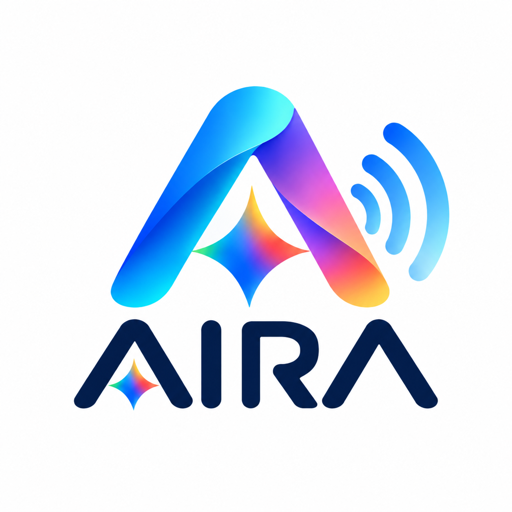

<p align="center"></p>

<h1 align="center">AIRA on Meta</h1>

<p align="center"><b>AIRA turns a blind person into a shop owner: serving customers, taking payment, counting cash and checking supplier deliveries, all by voice from one phone, with Meta's models as their eyes and back office.</b></p>

<p align="center">
Meta Global AI Developer Hackathon 2026 · Indie track · Team Techjays · Theme: <i>Build for Your World</i>
</p>

| | |
|---|---|
| **Live app** (phone web app, no install) | **https://meta-aira.web.app** |
| **Owner dashboard** | **https://meta-aira.web.app/dashboard/** |
| **Dashboard demo** (scripted data, no backend needed) | https://meta-aira.web.app/dashboard/?demo=1 |
| **Demo shop** | AIRA Cricket Store, Coimbatore (10 products, Tamil/English/Hindi names) |

---

## Why

Millions of blind people are able and willing to work, but running a small shop, one of the most common livelihoods in India, needs eyes for dozens of small jobs: knowing what a customer is holding, reading prices and supplier bills, counting cash and giving change, tracking stock, and checking that a delivery matches the invoice. AIRA does those jobs so the owner can run the business by voice, independently. **The owner makes every decision; AIRA is their eyes and back office.**

## How to use it

1. Open **https://meta-aira.web.app** on a phone (Android Chrome or iPhone Safari) and tap **Tap to start**. That one tap turns on the microphone, camera and speech.
2. A short device check confirms the mic and camera work.
3. **Double-tap anywhere to talk. Long-press to stop.** A single tap repeats AIRA's last line. While a confirmation is open, double-tap means **yes** and long-press means **no**.
4. Speak in **English, Tamil or Hindi**, for example:
   - "What is the price of a tennis ball?"
   - "Sell two tennis balls and one bat grip." → AIRA reads back the total (computed in code) and waits for "yes"
   - "The customer pays cash." → hold the notes up to the camera; two models must agree on the amount, then AIRA says the exact change
   - "A delivery of twelve tennis balls came, count them." → point the camera at the box; **SAM 3.1** counts the balls and AIRA reports any shortfall before adding stock
5. Open the **dashboard** on a laptop to watch sales, stock, the SAM 3.1 count with its boxes, two-model verification results and the live conversation.

## What it does

- **Serves customers:** answers price and stock questions from the shop catalog, in the owner's language.
- **Bills sales:** builds the sale, computes the total in code and reads it back before anything is recorded.
- **Takes cash safely:** the phone camera reads the notes; **two independent models must agree** on every note before AIRA says a number; change is computed in code. UPI payments are confirmed by the owner.
- **Checks supplier deliveries:** **SAM 3.1** counts the delivered items and the invoice is read by two models; a mismatch is spoken (*"I counted 10, the invoice says 12, 2 are missing"*) and only the counted number enters stock.
- **Keeps the books:** every sale, payment and delivery is written to an idempotent ledger only after the owner says **yes**.

## Meta models used and how

| Need | Meta model | How AIRA uses it |
|---|---|---|
| Agent brain | **Muse Spark 1.3** (`muse-spark-1.3-contributor`) | Dialogue, function calling over 10 shop tools, and vision, via the OpenAI-compatible Meta Model API with minimal reasoning effort for voice latency |
| Speech to text | **Muse Voice Transcribe 1.0** | Realtime WebSocket ASR (24 kHz PCM, paced in real time) with end-of-speech detection; Tamil, English and Hindi, with catalog names as keywords |
| Counting items | **SAM 3.1** | One noun phrase per request (e.g. "tennis ball") returns boxes and masks; parsed with `meta-sam-parser`; the count is the number of boxes above a confidence threshold |
| Second reader for cash and invoices | **Muse Spark 1.2** (a different generation from the first reader) | Reads the same frame independently; AIRA only speaks an amount when both readers agree. Swappable for open-weights **Muse Glimmer 30B** on Modal via config (`infra/modal_glimmer.py`) |
| Text to speech | Browser `speechSynthesis` (ta-IN / hi-IN / en-IN) | Meta has no TTS model |

All model IDs live in one file, `backend/aira/config.py`.

## Built during the hackathon

**All code in this repository was written during the hackathon (Oct 26 – Nov 4, 2026).** The git history is the record of that work. The product idea and visual design come from the team's earlier AIRA concept; everything here, backend, phone app, dashboard and infrastructure, was implemented from scratch for Meta's models. No earlier code was copied.

## Architecture

```
Phone web app (browser)                       Cloud Run "meta-aira" (FastAPI, Python 3.12)
 |- mic -> 24 kHz PCM16, 80 ms --- WebSocket --> Transcriber --> Muse Voice Transcribe (wss realtime)
 |- camera -> JPEG frame on request ---------->      | final transcript
 |- speaker <- browser TTS <- text <--------- Agent: Muse Spark tool-calling loop + safety guard
 '- confirm card (yes / no) <---------------         | tool calls
                                                     v
                               Tools (deterministic Python)
                                |- price / stock / sale / payment / day summary -> ledger store
                                |- read_cash      -> reader A + reader B, must agree
                                |- delivery_check -> SAM 3.1 count (+ invoice, two readers)
                                '- confirm_action -> propose -> spoken "yes" -> idempotent commit

Owner dashboard (/dashboard/)  <-- /api/snapshot, /api/stream (SSE), /api/frame/{id}
```

- **Backend:** `backend/aira/` (FastAPI). Agent loop `agent.py`, spoken-number guard `safety.py`, tools `tools/`, vision `vision/` (SAM 3.1, two-reader cash and invoice), voice `voice.py`, confirm-before-commit `confirm.py`, store `store.py` (in-memory; a Firestore implementation is included), spend guard `limits.py`.
- **Phone app:** `frontend/app/` (Vite + TypeScript, no framework). AudioWorklet resampler, camera capture, speech output, one-button gestures, English/Tamil/Hindi UI.
- **Dashboard:** `frontend/dashboard/` (Vite + TypeScript). Overview, Today, Stock, Prices, Orders & deliveries, and Live (SAM 3.1 frame with boxes, two-model checks, conversation).

## Safety principles

- **The model proposes, code commits.** The model never writes money or stock. Every change goes propose → spoken "yes" → commit.
- **Numbers come only from tools.** Totals, change and counts are computed in Python; a spoken-number guard checks that every amount or count AIRA says came from a tool result, and makes the model correct itself if not.
- **Two readers must agree** on cash and invoices; otherwise AIRA says it is not sure and asks to look again.
- **Evidence before state:** only the SAM-counted number of a delivery enters stock.
- **Idempotent writes:** a repeated "yes" never sells or adds stock twice.
- **Honest limits:** AIRA never describes or identifies people and never judges whether a note is genuine.

## Verified

- **172 backend tests** pass offline (mock mode), including an end-to-end demo over the real WebSocket: sale → two-reader cash payment → idempotent "yes" → SAM delivery count.
- **Live checks against the Meta Model API:** Muse Spark tool calling (sale ₹240 by UPI, stock updated once), SAM 3.1 counting 7 of 7 objects, Voice Transcribe realtime session, and the full flow through the deployed Cloud Run service.
- CI runs lint, tests and both frontend builds on every pull request.

## Run locally

Requirements: Python 3.12 with [uv](https://docs.astral.sh/uv/), Node 20+.

```bash
# Backend: mock mode (no key, nothing billed), in-memory store
cd backend
uv sync
AIRA_MOCK=1 uv run uvicorn aira.main:app --reload --port 8080 --ws websockets
uv run pytest -q            # offline tests
uv run ruff check aira tests

# Phone app (new terminal)
cd frontend/app && npm install
VITE_BACKEND_WS=ws://localhost:8080/ws npm run dev

# Owner dashboard (new terminal)
cd frontend/dashboard && npm install
VITE_BACKEND_URL=http://localhost:8080 npm run dev
```

To use the real models, set `MODEL_API_KEY` (a Meta Model API key), `APP_KEY` (any shared string) and `AIRA_MOCK=0` in `backend/.env`. See `.env.example` for every setting. The microphone and camera need a secure context: use `localhost`, or an HTTPS tunnel for a real phone.

## Deployment

- **Backend:** Cloud Run service `meta-aira` (asia-south1): 1 vCPU / 512 MiB, one instance, 3600 s timeout and session affinity for WebSockets. Settings come from `infra/cloudrun.env.yaml`; `MODEL_API_KEY` and `APP_KEY` are mounted from Secret Manager and are **never stored in this repository**.
- **Web apps:** Firebase Hosting site `meta-aira` (phone app at `/`, dashboard at `/dashboard/`), deployed with `infra/hosting_deploy.py`.
- **Continuous deployment:** every push to `main` runs `.github/workflows/deploy.yml`: tests, then a keyless (OIDC / Workload Identity) deploy of the backend and both web apps, then a smoke test. No credentials are stored in GitHub.
- **Access and spend control:** as in the original AIRA, the web apps use a shared demo key (fetched from the backend at startup). Model spend is capped server-side per caller and globally (`backend/aira/limits.py`), and CORS allows only the AIRA site.
- **Optional open-weights second reader:** `modal deploy infra/modal_glimmer.py` serves Muse Glimmer 30B with vLLM; point `READER2_BASE_URL` / `READER2_MODEL` at it.

## Repository layout

```
backend/            FastAPI service (aira/), tests/ (172 offline tests), Dockerfile
frontend/app/       Phone web app (PWA)
frontend/dashboard/ Owner dashboard (with ?demo=1 mode)
infra/              Cloud Run env file, Hosting deploy script, guarded GCP scripts, Modal Glimmer server
.github/workflows/  ci.yml (pull requests), deploy.yml (push to main)
```

## Current limitations

- The demo store is in memory, so shop data resets when the service restarts (a Firestore store is implemented but not yet switched on).
- Supplier ordering, walking guidance and hand guidance from the original AIRA concept are not part of this build.
- Replies take a few seconds; latency tuning is ongoing.

## License

[MIT](LICENSE) © 2026 Saravana Rajan
